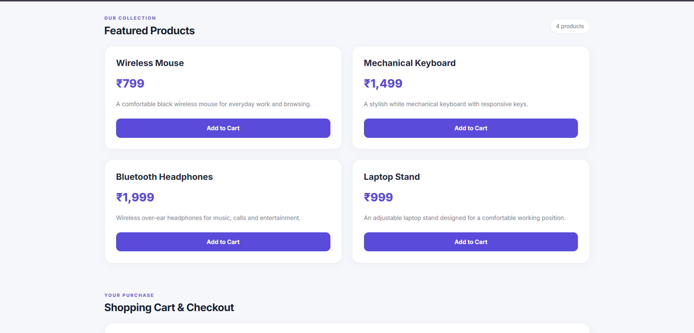
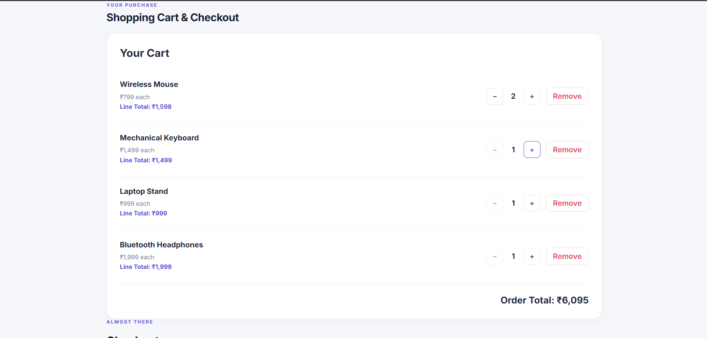
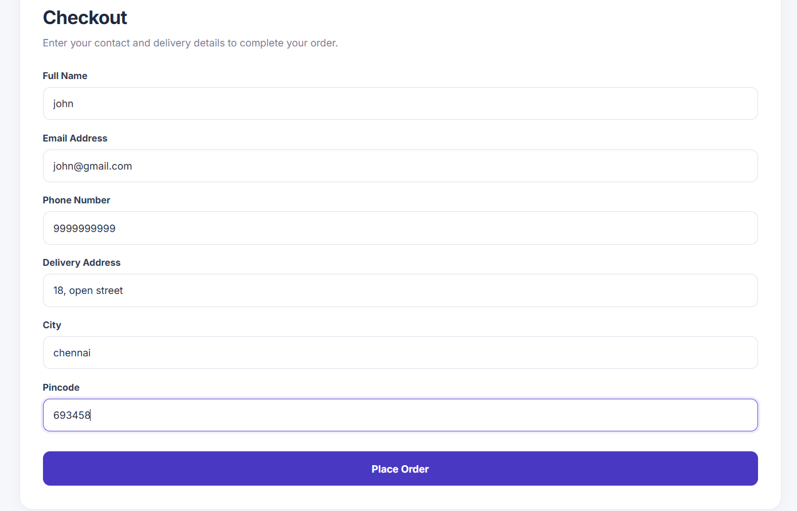
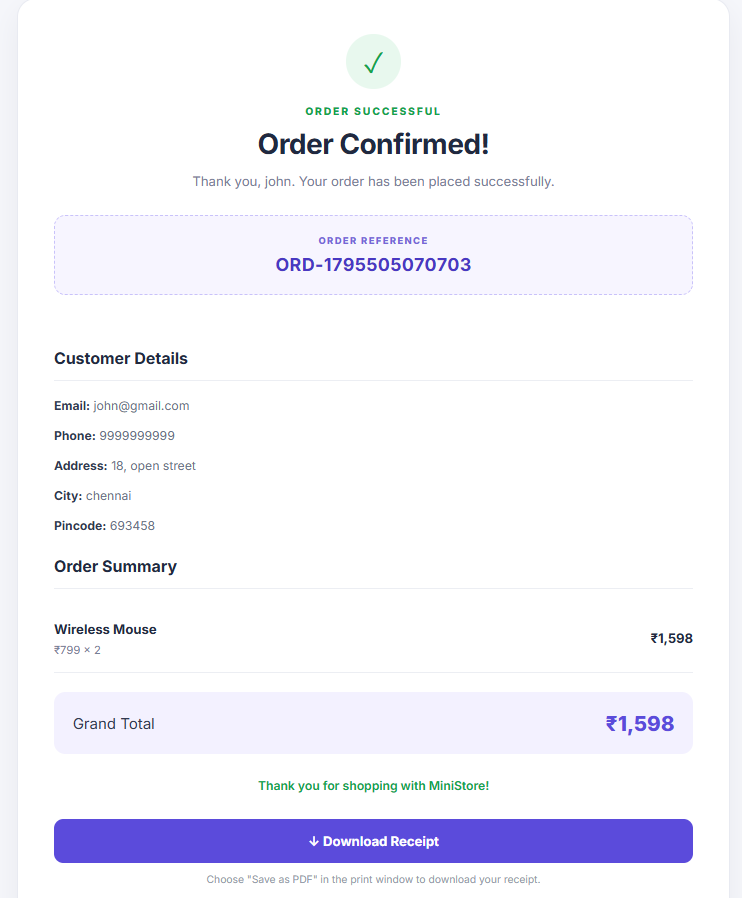
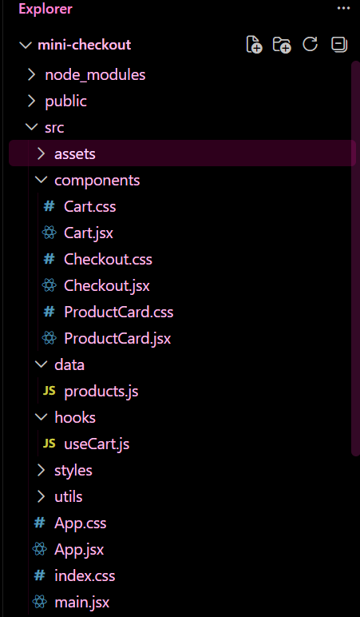
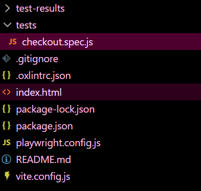

# MiniStore – E-Commerce Checkout Application

A responsive mini e-commerce application built using **React, Vite, JavaScript, and CSS**. Users can browse products, manage their shopping cart, enter delivery information, and complete a checkout flow with an order confirmation receipt.

The application also includes browser automation testing using Playwright.

## Project Overview

MiniStore demonstrates a simplified real-world online shopping experience with product management, cart functionality, customer information validation, persistent cart storage, and order confirmation.

## Features

### 1. Product Catalogue
- Displays four products with fixed prices.
- Product descriptions and pricing.
- Add products to the shopping cart.

### 2. Shopping Cart
- Add multiple products.
- Increase and decrease product quantities.
- Remove products from the cart.
- Automatically calculate individual line totals.
- Automatically update the grand total.
- Display an empty-cart message when no products are available.

### 3. Checkout and Form Validation
Collects the following customer information:

- Full Name
- Email Address
- Phone Number
- Delivery Address
- City
- Pincode

Validation includes:
- Required field validation.
- Minimum name length.
- Email format validation.
- 10-digit Indian mobile number validation.
- 6-digit pincode validation.
- Prevents checkout when the cart is empty.
- Prevents duplicate order submissions.

### 4. Order Confirmation
- Generates a unique order reference.
- Displays customer details.
- Displays purchased products and quantities.
- Shows individual product totals and grand total.
- Provides a professional order confirmation receipt.

### 5. Download Receipt
- Includes a Download Receipt option.
- Uses the browser print functionality.
- Allows users to save the order receipt as a PDF.

### 6. LocalStorage Persistence
- Saves cart information in browser LocalStorage.
- Retains cart items and quantities after page refresh.
- Updates stored cart data when products are added, removed, or quantities change.

## Technologies Used

| Technology | Purpose |
|---|---|
| React | User interface development |
| Vite | Development server and build tool |
| JavaScript | Application logic |
| CSS | Styling and responsive layout |
| Playwright | Automated browser testing |
| LocalStorage | Cart data persistence |

## Project Structure

```text
mini-checkout/
├── public/
├── src/
│   ├── assets/
│   ├── components/
│   │   ├── Cart.jsx
│   │   ├── Cart.css
│   │   ├── Checkout.jsx
│   │   ├── Checkout.css
│   │   ├── ProductCard.jsx
│   │   └── ProductCard.css
│   ├── data/
│   │   └── products.js
│   ├── hooks/
│   │   └── useCart.js
│   ├── App.jsx
│   ├── App.css
│   └── index.css
├── tests/
│   └── checkout.spec.js
├── playwright.config.js
├── package.json
└── README.md
```

## Installation and Setup

### Prerequisites
- Node.js
- npm

### Step 1: Install dependencies

```bash
npm install
```

### Step 2: Install Playwright browser

```bash
npx playwright install chromium
```

### Step 3: Start the development server

```bash
npm run dev
```

Open the local URL displayed in the terminal to access MiniStore.

## Running Automated Tests

Run the complete Playwright test suite:

```bash
npm run test:e2e
```

The tests execute using Chromium.

## Automated Test Results

**Latest reported test execution: 16 passed, 0 failed.**

| No. | Test Scenario | Result |
|---:|---|---|
| 1 | Successful checkout and order confirmation | Passed |
| 2 | Empty cart checkout prevention | Passed |
| 3 | Quantity change updates exact total | Passed |
| 4 | Adding the same product increases quantity | Passed |
| 5 | Removing a product from cart | Passed |
| 6 | Removing the last product shows empty cart | Passed |
| 7 | Whitespace-only name validation | Passed |
| 8 | One-character name validation | Passed |
| 9 | Invalid email validation | Passed |
| 10 | Invalid phone number validation | Passed |
| 11 | Empty address validation | Passed |
| 12 | Empty city validation | Passed |
| 13 | Invalid pincode validation | Passed |
| 14 | Adding all four products and checking total | Passed |
| 15 | Rapid double-click duplicate order prevention | Passed |
| 16 | Cart persistence after page refresh | Passed |

## Manual Testing

The following behaviours were also checked during development:

- Checkout validation with customer details.
- Cart persistence after refreshing the browser.
- Order confirmation and customer information display.
- Receipt layout and PDF save functionality.

## Project Limitations

- Product information uses fixed sample data.
- Cart data is stored in browser LocalStorage.
- There is no backend or database integration.
- Orders are not permanently stored.
- No real payment gateway is connected.
- PDF generation uses the browser's print-to-PDF functionality.

## Future Enhancements

- Backend integration and permanent order storage.
- User authentication.
- Product search and filtering.
- Product inventory management.
- Payment gateway integration.
- Order history and tracking.

## Conclusion

MiniStore demonstrates the essential workflow of an e-commerce checkout application, including product selection, shopping cart management, customer form validation, persistent cart storage, order confirmation, and automated browser testing using Playwright.


## Project Screenshots

### 1. Product Catalogue


### 2. Shopping Cart


### 3. Checkout Form


### 4. Order Confirmation Receipt


### 5. Project Structure


